# AICTE Sentinel — SIH 2026 Judge Demonstration Runbook

**Problem Statement ID:** 26262  
**System Name:** AICTE Sentinel — Comprehensive Regulatory Approval Workflow & Compliance Intelligence Platform  
**Target Event:** Smart India Hackathon (SIH) 2026 Grand Finale  
**Target Release Candidate:** Phase 8 / v1.0.0-rc1  
**Repository Working Directory:** `C:\Users\mudit\Downloads\26262`  
**Git Baseline Commit:** `53da828`  

---

## 1. Executive Demonstration Overview

**AICTE Sentinel** is an enterprise-grade statutory governance, regulatory approval workflow, and compliance intelligence system architected strictly according to the **AICTE Approval Process Handbook (APH) 2026-27**. 

This runbook provides an evidence-based, step-by-step presentation script designed for SIH judges and evaluators. Every demonstration step explicitly details the acting user persona, exact API endpoints invoked, database mutations, UI results, and cryptographic audit ledger events.

---

## 2. Demo Environment Setup & Reproducible Reset

To ensure an identical, deterministic evaluation state for every judging round, run the automated reset utility:

### 2.1 One-Step Reset Command
```powershell
# From repository root (C:\Users\mudit\Downloads\26262):
.\.venv\Scripts\python scripts/reset_demo.py
```

**What this utility performs deterministically:**
1. Wipes the local demonstration database (`sentinel_dev.db`).
2. Runs all 6 Alembic database migrations up to `006_postgresql_rls (head)`.
3. Seeds synthetic institutions, 5 role personas, workflow templates, EVC panels, hearing dockets, APH 2026-27 clauses, and pre-trained delay-risk models.
4. Cryptographically verifies the SHA-256 audit ledger from the Genesis block to the active chain head.

### 2.2 Launching the Demonstration Servers

In two separate terminal windows, start the backend and frontend:

**Terminal 1 (FastAPI Backend API):**
```powershell
.\.venv\Scripts\python -m uvicorn app.main:app --host 127.0.0.1 --port 8000 --app-dir backend
```
*Health Probe:* `http://127.0.0.1:8000/api/health` (HTTP 200)

**Terminal 2 (React + Vite Frontend):**
```powershell
npm --prefix frontend run dev
```
*Portal Access:* `http://127.0.0.1:5173`

---

## 3. Demo Persona Accounts Cheat-Sheet

All demonstration personas use synthetic credentials strictly isolated from production:

| # | Role | Full Name & Title | Email Address | Password | Assigned Scope |
|:---:|:---|:---|:---|:---|:---|
| 1 | `INSTITUTION_ADMIN` | **Dr. Sunita Aggarwal** (Director) | `director@ditm-delhi.edu.in` | `College@2026!` | Delhi Institute of Technology & Management |
| 2 | `SCRUTINY_OFFICER` | **Shri K. Sundaram** (Senior Scrutiny Officer) | `scrutiny.lead@aicte-india.org` | `Scrutiny@2026!` | Northern Region Scrutiny Desk |
| 3 | `REGIONAL_OFFICER` | **Prof. Anita Deshmukh** (Regional Director) | `ro.delhi@aicte-india.org` | `Regional@2026!` | Northern Regional Office |
| 4 | `EVC_EXPERT` | **Prof. Manas Ranjan Pradhan** (EVC Chairperson) | `evc.prof@iitd.ac.in` | `Expert@2026!` | National Expert Inspection Pool |
| 5 | `SUPER_ADMIN` | **Dr. Rajesh V. Sharma** (Member Secretary) | `superadmin@aicte-india.org` | `Sentinel@Admin2026!` | AICTE Central Council Governance |

---

## 4. The 12-Step Judge-Facing Demonstration Journey

```mermaid
flowchart LR
    A["1. Institution Login & Dashboard"] --> B["2. Docket Creation & Intake"]
    B --> C["3. Document Upload & Scrutiny"]
    C --> D["4. Deficiency Notice & Clarification"]
    D --> E["5. EVC Assignment & Conflict Check"]
    E --> F["6. EVC Report & Recommendation"]
    F --> G["7. Standing Committee Hearing"]
    G --> H["8. Final Council Decision & Audit"]
    H --> I["9. Post-Approval Obligations"]
    I --> J["10. Deadline Monitoring & Escalation"]
    J --> K["11. Explainable Delay-Risk AI"]
    K --> L["12. Grounded APH Assistant RAG"]
```



---

### Step 1: Institution Login & Personalized Command Center
- **Presenter Action:** Navigate to `http://127.0.0.1:5173/login`, enter `director@ditm-delhi.edu.in` / `College@2026!`, and click **Authenticate & Access Docket**.
- **User Role:** `INSTITUTION_ADMIN` (Dr. Sunita Aggarwal).
- **API Request:** `POST /api/v1/auth/login` -> `GET /api/v1/auth/me`.
- **Database State:** Validates password hash via Argon2; generates JWT bearer token with claims `{ sub, roles: ["INSTITUTION_ADMIN"], institution_id }`.
- **Visible UI Result:** Command Center displays header badge `"Dr. Sunita Aggarwal • Delhi Institute of Technology & Management (INSTITUTION_ADMIN)"` with KPI counters.
- **Audit Event:** `AUTH_LOGIN_SUCCESS` (Target: User `director@ditm-delhi.edu.in`).
- **Execution Nature:** **LIVE EXECUTED WORKFLOW**.

---

### Step 2: Application Docket Creation & Intake Submission
- **Presenter Action:** Navigate to **Statutory Applications** (`/applications`), verify strict tenant isolation (only DITM dockets visible, zero leakage of Pune or Bangalore dockets). Click **Initiate New Application**, select `"Extension of Approval (EoA) 2026-27"`, enter Primary Program `"Artificial Intelligence & Data Science"`, Intake `"420"`, and click **Create Application Draft**.
- **User Role:** `INSTITUTION_ADMIN`.
- **API Request:** `POST /api/v1/applications` (Payload: `{ template_id, academic_year: "2026-2027", submission_data: { intake_capacity: 420, primary_discipline: "AI & DS" } }`).
- **Database Mutation:** Inserts record into `applications` with `current_status: "DRAFT"`, binds `institution_id = ditm.id`.
- **Visible UI Result:** Modal dismisses smoothly; new docket (`AICTE-2026-EOA-XXXXX`) appears immediately in the applications table with status badge `"Draft"`.
- **Audit Event:** `APPLICATION_CREATED` (Resource: `Application`).
- **Execution Nature:** **LIVE EXECUTED WORKFLOW**.

---

### Step 3: Document Upload, Byte-Level Scanning & Officer Scrutiny
- **Presenter Action:** Click **Inspect Docket →** on the newly created docket. Switch to **Document Checklist** tab. Click **Upload Regulatory Document**, select category `"Fire & Safety NOC"`, attach a sample PDF (`sample_fire_noc.pdf`), and submit. Then log in as Scrutiny Officer (`scrutiny.lead@aicte-india.org`), switch to **Scrutiny Workspace** tab, record finding `"Building Safety & Fire Plan"`, select status `"DEFICIENT"`, reason `"Fire NOC expired on 14-Jan-2026"`, and submit finding.
- **User Role:** `INSTITUTION_ADMIN` (Upload) -> `SCRUTINY_OFFICER` (Review).
- **API Requests:** 
  1. `POST /api/v1/applications/{id}/documents` (`multipart/form-data`)
  2. `POST /api/v1/applications/{id}/scrutiny`
- **Security Check:** `file_validator.py` verifies 15 MB limit and `%PDF-` magic bytes. ClamAV INSTREAM protocol scans payload.
- **Database Mutation:** Inserts `documents` (`scan_status: "ACCEPTED"`), inserts `scrutiny_findings` (`finding_status: "DEFICIENT"`).
- **Visible UI Result:** Scrutiny table updates immediately displaying deficient finding badge with officer timestamp.
- **Audit Event:** `DOCUMENT_UPLOADED`, `SCRUTINY_FINDING_RECORDED`.
- **Execution Nature:** **LIVE EXECUTED WORKFLOW**.

---

### Step 4: Statutory Deficiency Notice & Clarification Response
- **Presenter Action:** As Scrutiny Officer, switch to **Deficiency Notices** tab, click **Issue Statutory Deficiency Notice**, enter Cure Window `"7 Days"`, Remarks `"Provide renewed State Fire Services NOC certificate"`, and click **Issue Notice**. Then switch back to Institution Admin view (`director@ditm-delhi.edu.in`), view active notice alert, click **Submit Clarification Response**, input official clarification `"Renewed provisional NOC DFS/2026/RN-112 attached"`, and submit.
- **User Role:** `SCRUTINY_OFFICER` (Issuance) -> `INSTITUTION_ADMIN` (Response).
- **API Requests:**
  1. `POST /api/v1/applications/{id}/deficiencies`
  2. `POST /api/v1/deficiencies/{notice_id}/response`
- **Database Mutation:** Inserts `deficiency_notices` (`status: "ISSUED"`, `cure_deadline`), updates notice to `status: "RESPONDED"`, records response remarks.
- **Visible UI Result:** Docket state reflects active deficiency cure window; clarification response appears in chronological notice history.
- **Audit Event:** `DEFICIENCY_NOTICE_ISSUED`, `DEFICIENCY_RESPONSE_SUBMITTED`.
- **Execution Nature:** **LIVE EXECUTED WORKFLOW**.

---

### Step 5: EVC Assignment & Automated Conflict-of-Interest Checks
- **Presenter Action:** Log in as Regional Officer (`ro.delhi@aicte-india.org`). Navigate to **EVC Inspections & Pool** (`/evc`). Show the **National Expert Roster** with automated state and institutional conflict masking. Click **Schedule EVC Inspection** for an active docket.
- **User Role:** `REGIONAL_OFFICER`.
- **API Request:** `POST /api/v1/evc/inspections` -> `GET /api/v1/evc/conflicts/check`.
- **Security Guardrail:** `conflict_service.py` evaluates Alma Mater, prior employment, and state jurisdiction. If an expert was educated or previously employed at DITM, automated assignment is rejected with HTTP 409 Conflict.
- **Database Mutation:** Inserts `evc_inspections` and `evc_inspection_experts`.
- **Visible UI Result:** Scheduled inspection card appears with assigned panel members (`Dr. Ananya Sengupta`, `Dr. Sunita Mehra`).
- **Audit Event:** `EVC_INSPECTION_SCHEDULED`.
- **Execution Nature:** **LIVE EXECUTED WORKFLOW & SEEDED DEMO DATA**.

---

### Step 6: Inspection Report Submission & Chairperson Recommendation
- **Presenter Action:** Log in as EVC Expert (`evc.prof@iitd.ac.in`). Open EVC Inspection docket `EVC-AICTE-2026-NEW-99341-001`. Review infrastructure scores (Classrooms: 95/100, Labs: 90/100, Library: 92/100). Show the SHA-256 digital signature of the submitted versioned report (`v1`).
- **User Role:** `EVC_EXPERT` (Prof. Manas Ranjan Pradhan).
- **API Request:** `GET /api/v1/evc/inspections/{id}/reports`.
- **Database State:** `evc_report_versions` record containing `sha256_hash: 568bf688...`, `recommendation: "RECOMMENDED"`, `composite_score: 92.5`.
- **Visible UI Result:** Green verified inspection badge `"RECOMMENDED (Infrastructure Score: 92.5/100) — SHA256: 568bf688..."`.
- **Audit Event:** `EVC_REPORT_SUBMITTED`.
- **Execution Nature:** **SEEDED HIGH-FIDELITY DEMONSTRATION RECORD**.

---

### Step 7: Standing Hearing Committee (SHC) Session & Quorum
- **Presenter Action:** Log in as Regional Director (`ro.delhi@aicte-india.org`). Navigate to **Committees & Hearings** (`/committees`). Open **Standing Hearing Committee (Northern Region)**. Inspect hearing session `SHC-NR-2026-001`.
- **User Role:** `REGIONAL_OFFICER`.
- **API Request:** `GET /api/v1/committees/hearings/{id}`.
- **Statutory Rules:** Quorum requires at least 3 members (Chairperson, Legal Expert, Academic Expert). Attendance is verified before docket deliberation.
- **Database State:** `hearings` record linked to `hearing_dockets`, recording attendance and committee minutes.
- **Visible UI Result:** Quorum counter displays `"Quorum Attained: 3/3 Members Present"`; docket hearing recommendations listed.
- **Audit Event:** `HEARING_CONVENED`, `MINUTES_RECORDED`.
- **Execution Nature:** **SEEDED HIGH-FIDELITY DEMONSTRATION RECORD**.

---

### Step 8: Final Statutory Decision & Cryptographic Audit Verification
- **Presenter Action:** Log in as Central AICTE Super Admin (`superadmin@aicte-india.org`). Navigate to **Statutory Decisions** (`/decisions`). Inspect signed decision `AICTE-DEC-AICTE-2026-EOA-77412`. Then navigate to **Audit Hash-Chain Ledger** (`/audit`) and click **Run Cryptographic Hash Check**.
- **User Role:** `SUPER_ADMIN` (Dr. Rajesh V. Sharma).
- **API Request:** `GET /api/v1/decisions` -> `GET /api/v1/audit/verify`.
- **Database State:** `statutory_decisions` record with approval grant date, approved intake (360 seats), and signed remarks.
- **Visible UI Result:** Decision Certificate renders with official AICTE emblem, seal, and authorized signatory details. Audit Ledger displays `"Cryptographic Chain Status: Verified Untampered"` with active chain head SHA-256 hash.
- **Audit Event:** `DECISION_AUTHORIZED`, `AUDIT_CHAIN_VERIFIED`.
- **Execution Nature:** **LIVE EXECUTED WORKFLOW & VERIFIED CHAIN**.

---

### Step 9: Post-Approval Obligations & Evidence Review (M14)
- **Presenter Action:** Navigate to **Compliance & Monitoring** (`/compliance`). Show the 4 statutory KPI summary cards (`Total Obligations: 4`, `Compliant: 1`, `Under Review: 1`, `Deficient: 1`). Click **Statutory Obligations Register** (`/compliance/obligations`). Inspect obligation `OBL-DEMO-FSR-2026` ("DEMO Annual Faculty-Student Ratio Mandatory Compliance Disclosure").
- **User Role:** `SUPER_ADMIN` / `REGIONAL_OFFICER`.
- **API Request:** `GET /api/v1/compliance/obligations` -> `GET /api/v1/compliance/obligations/{id}`.
- **Statutory Logic:** Bound to approved institutions under APH Clause 4.1.1. Supports institution evidence upload, officer verification, rejection, and resubmission.
- **Visible UI Result:** Obligation detail renders category `"FACULTY RATIO ANNUAL"`, due date, and verified compliance status badge.
- **Audit Event:** `OBLIGATION_EVALUATED`.
- **Execution Nature:** **LIVE EXECUTED WORKFLOW & SEEDED RECORDS**.

---

### Step 10: Deadline Calendar, Worker Alerts & CSV Export (M15–M16)
- **Presenter Action:** 
  1. Click **Renewal & Expiry Tracking Calendar** (`/compliance/calendar`). Point out dynamic urgency bands (`CRITICAL_7_DAYS`, `APPROACHING_30_DAYS`).
  2. Click **Statutory Compliance Reports & Analytics** (`/compliance/reports`).
  3. Click **Export Compliance CSV**. Open the exported file to demonstrate OWASP formula injection protection (leading `=`, `+`, `-`, `@` characters safely neutralized with leading apostrophe).
- **User Role:** `SUPER_ADMIN` / `REGIONAL_OFFICER`.
- **API Requests:**
  1. `GET /api/v1/compliance/deadlines?days_ahead=60`
  2. `GET /api/v1/compliance/reports/export?format=csv`
- **Security Check:** `csv_sanitizer` ensures spreadsheet safety against remote command execution. Background worker `compliance_worker.py` deduplicates alerts (24-hour escalation window).
- **Visible UI Result:** Real-time deadline calendar with color-coded urgency badges; clean downloadable CSV spreadsheet.
- **Audit Event:** `COMPLIANCE_REPORT_EXPORTED`.
- **Execution Nature:** **LIVE EXECUTED WORKFLOW**.

---

### Step 11: Explainable Delay-Risk Intelligence & Attributions (M11)
- **Presenter Action:** Navigate to **Delay-Risk Intelligence** (`/intelligence`). Show the **Statutory Guardrail Notice** explaining that AI provides statistical advisory assistance only and does NOT make statutory decisions or mutate workflow states. Point out the gradient boosting risk score for `AICTE-2026-NEW-99341` (68% Elevated) with additive factor attributions (`unresolved_deficiencies: +32% risk`).
- **User Role:** `SUPER_ADMIN` / `REGIONAL_OFFICER`.
- **API Request:** `GET /api/v1/intelligence/delay-risk/overview` -> `GET /api/v1/intelligence/models`.
- **Machine Learning Specification:** Supervised ensemble model (`v1.2.0-sentinel-supervised`) trained strictly on historical pre-decision features (zero future outcome leakage). Transparent model registry displays accuracy: 65.3%, ROC-AUC: 0.728.
- **Visible UI Result:** Interactive risk breakdown table with feature attribution progress bars and governance disclaimer.
- **Audit Event:** `INTELLIGENCE_ADVISORY_RENDERED`.
- **Execution Nature:** **LIVE EXECUTED MODEL & SEEDED PREDICTIONS**.

---

### Step 12: Grounded APH Regulatory Assistant & Uncertainty Fallback (M13)
- **Presenter Action:** Navigate to **APH Regulatory Assistant** (`/aph-assistant`).
  1. **Positive Path (Valid Query):** Enter:
     > *"What is the mandatory Faculty-to-Student Ratio (FSR) for Degree Engineering programmes?"*
     Click **Ask**. Highlight the authoritative citation returned: **Chapter 4, Clause 4.1.1 (Page 68)** specifying ratio `1:20` and cadre ratio `1:2:6`.
  2. **Negative Path (Out-of-Corpus Query):** Enter:
     > *"How to bake authentic Neapolitan sourdough pizza at 450 degrees?"*
     Click **Ask**. Demonstrate the **Uncertainty Guardrail Notice**: system refuses to answer and states insufficient corpus coverage, completely eliminating AI hallucination.
- **User Role:** Any authenticated user.
- **API Request:** `POST /api/v1/aph/ask` (Payload: `{ query: "..." }`).
- **RAG Architecture:** Lexical-semantic vector retrieval over official APH 2026-27 indexed handbook clauses. Retrieval threshold guardrail (0.35) triggers refusal if query similarity is below statutory certainty bounds.
- **Visible UI Result:** Citation card with clickable clause reference; amber uncertainty alert for out-of-corpus queries.
- **Audit Event:** `APH_ASSISTANT_QUERY`.
- **Execution Nature:** **LIVE EXECUTED RAG INFERENCE**.

---

## 5. Technical Questions & Judge Defense Guide

### Q1: "How do you prevent cross-tenant data leakage between competing technical colleges?"
> **Answer:** "Multi-tenant isolation is enforced at two distinct architectural layers:
> 1. **Application Layer (`TenantContext` & FastAPI dependencies):** Every database query inspects the authenticated user's JWT claims. For `INSTITUTION_ADMIN` roles, queries are filtered strictly by `institution_id == current_user.institution_id`.
> 2. **Database Engine Layer (PostgreSQL RLS):** Migration `006_postgresql_rls` installs `ROW LEVEL SECURITY` and `FORCE ROW LEVEL SECURITY` on `institutions`, `applications`, `documents`, `deficiency_notices`, and `compliance_obligations`. Session identifiers are sanitized with strict alphanumeric regex whitelist (`^[A-Za-z0-9_\-\.:]+$`) and session variables are reset upon connection return (`RESET app.current_tenant`)."

### Q2: "Can an administrator secretly alter an inspection report or approval decision in the database?"
> **Answer:** "No. Every statutory transition, document upload, scrutiny remark, and decision is cryptographically anchored in an append-only SHA-256 hash-chained ledger (`audit_events`). Each record's entry hash is computed as:
> `SHA256(previous_entry_hash | sequence_number | actor_id | action | resource_type | resource_id | payload_hash)`
> Any out-of-band database update or sequence deletion immediately breaks the cryptographic linkage, triggering an immediate ledger tamper alert on `/audit`."

### Q3: "What if an institution uploads malware or a corrupted document?"
> **Answer:** "Our document ingestion pipeline implements a fail-closed multi-tier security inspection:
> 1. **Size Constraints:** Enforces 15 MB statutory limit; rejects 0-byte uploads.
> 2. **Binary Magic Bytes:** Verifies file header bytes (`%PDF-` for PDF, `FF D8 FF` for JPEG, `89 50 4E 47` for PNG), rejecting spoofed file extensions.
> 3. **ClamAV Network Daemon Scanning:** Documents are initially stored in a quarantined bucket. If ClamAV detects malware (e.g. EICAR test signature) or if the scanning daemon is offline, the document is quarantined and blocked from download or officer access. It is promoted to the clean vault only upon verified clean scan completion."

### Q4: "Does your AI replace statutory council officers or make automated decisions?"
> **Answer:** "Under AICTE regulatory policy, statutory decisions must remain with human constitutional authorities. Our AI models (delay-risk predictor and APH assistant) operate strictly as decision-support advisory systems:
> - Risk scores are statistical guidelines derived from document completeness and regional SLAs.
> - The APH Assistant includes an uncertainty guardrail that refuses out-of-corpus queries without guessing.
> - All UI screens feature persistent statutory governance notices explicitly barring autonomous AI workflow mutations."
