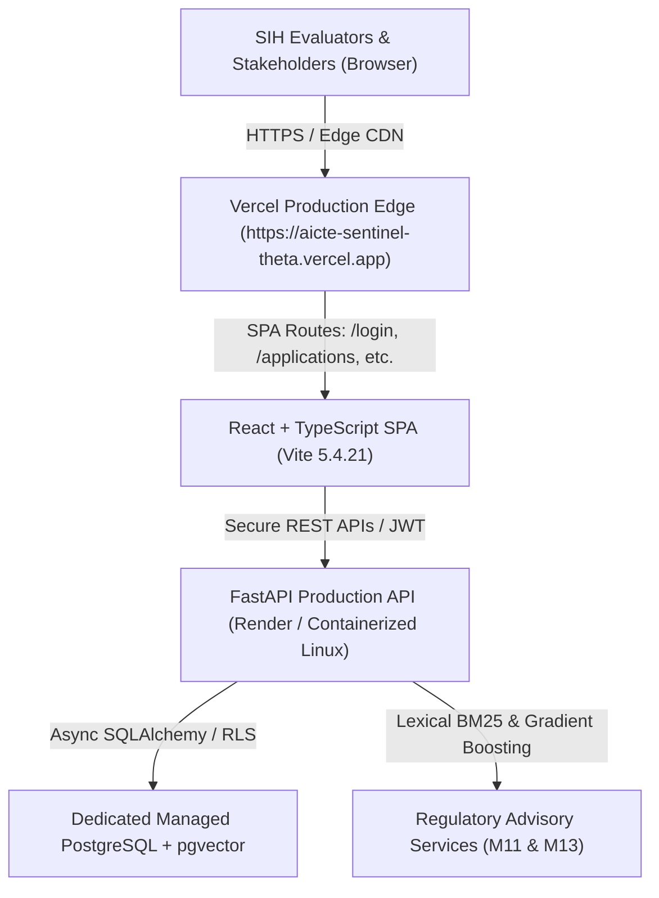

# AICTE Sentinel — Vercel Frontend Deployment Architecture & Plan

**System Name:** AICTE Sentinel — Comprehensive Statutory Regulatory Approval & Compliance Intelligence Platform  
**Problem Statement ID:** Smart India Hackathon (SIH) 2026 — Problem Statement 26262  
**Target Platform:** Vercel (Frontend SPA Hosting) & Decoupled Containerized Backend (Render / Cloud Engine)  
**Date:** October 26, 2026  
**GitHub Repository:** [https://github.com/muditk-dev/aicte-sentinel](https://github.com/muditk-dev/aicte-sentinel)  
**Production Vercel URL:** [https://aicte-sentinel-theta.vercel.app](https://aicte-sentinel-theta.vercel.app)  

---

## 1. Architectural Strategy: Decoupled Edge Frontend + Dedicated Backend

AICTE Sentinel separates the user presentation interface from the statutory state machine and compliance intelligence pipeline:



### 1.1 Why Vercel Edge for Frontend
1. **Global CDN & Ultra-Low Latency:** Instant delivery of minified JavaScript, CSS, and asset chunks across edge PoPs worldwide.
2. **Deterministic SPA Routing:** Clean URL rewrites (`/(.*) -> /index.html`) prevent HTTP 404 errors on deep refresh (e.g. `/applications/AICTE-2026-EOA-10821`).
3. **Zero Secrets in Client Bundle:** Static code reads runtime endpoints strictly via `VITE_API_BASE_URL`, never exposing backend database credentials, JWT secret keys, or local file paths.

### 1.2 Why the Backend is Kept Separate
- **Vercel Serverless Constraints:** Vercel Python runtime operates as ephemeral AWS Lambda functions with short execution timeouts (10s–60s) and read-only ephemeral `/tmp` storage.
- **Stateful Statutory Requirements:** AICTE Sentinel requires long-lived database connection pooling, persistent SQLite/PostgreSQL storage, background deadline monitoring (`compliance_worker.py`), and continuous SHA-256 cryptographic audit chaining.
- **Optimal Target:** A containerized Linux web service (such as Render or Railway) backed by a managed PostgreSQL instance with Row-Level Security enabled.

---

## 2. Vercel Configuration Specifications

### 2.1 Project Structure & Routing
- **Project Name:** `aicte-sentinel`
- **Vercel Team Scope:** `raya25` (muditkatremk-3479)
- **Framework Preset:** `Vite`
- **Root Directory:** `frontend`
- **Build Command:** `tsc -b && vite build`
- **Output Directory:** `dist`

### 2.2 SPA Rewrite Rules (`frontend/vercel.json`)
```json
{
  "rewrites": [
    {
      "source": "/(.*)",
      "destination": "/"
    }
  ]
}
```

### 2.3 Dynamic API Base Integration (`frontend/src/lib/api.ts`)
```typescript
const API_BASE = import.meta.env.VITE_API_BASE_URL
  ? `${(import.meta.env.VITE_API_BASE_URL as string).replace(/\/$/, '')}/api/v1`
  : '/api/v1'
```
- **Local Development:** When `VITE_API_BASE_URL` is unset, requests default to `/api/v1`, transparently proxied by Vite dev server to `http://127.0.0.1:8000`.
- **Vercel Production:** Setting `VITE_API_BASE_URL=https://aicte-sentinel-backend.onrender.com` dynamically dispatches API calls directly to the live backend with CORS headers.

### 2.4 Build-Time Variable Inlining & Production Redeployment
- **Vite Build Inlining:** In a Vite SPA, environment variables prefixed with `VITE_` are statically evaluated and inlined into the client-side JavaScript bundle during the build phase (`npm run build`) via `import.meta.env.VITE_API_BASE_URL`.
- **Production Redeployment Trigger:** When `VITE_API_BASE_URL` is configured in Vercel Project Settings (`https://aicte-sentinel-backend.onrender.com`), prebuilt deployments cannot read the new value at runtime. A new commit pushed to `origin/master` triggers a clean production build on Vercel, ensuring the live backend URL is compiled into the static distribution assets (`dist/assets/*.js`).

---

## 3. Environment Variable Configuration Matrix

| Variable Name | Environment | Purpose & Value Format | Example Production Value |
|:---|:---:|:---|:---|
| `VITE_API_BASE_URL` | Vercel (Production) | Base origin URL of the deployed FastAPI backend | `https://aicte-sentinel-backend.onrender.com` |
| `NODE_ENV` | Vercel (System) | Standard node environment identifier | `production` |
| `VITE_APP_TITLE` | Vercel (Optional) | Custom portal title in browser tabs | `AICTE Sentinel 2026` |

---

## 4. Verification Checkpoints

1. [x] **Repository Tracked:** Pushed to `https://github.com/muditk-dev/aicte-sentinel` (branch `master`).
2. [x] **Zero Secrets in Git:** `.env`, `.db`, `sentinel_dev.db`, and local vaults strictly ignored by `.gitignore`.
3. [x] **TypeScript Validation:** `tsc -b` compiles cleanly with zero type errors.
4. [x] **Vercel Production Build:** Built via Vercel Compiler (`.vercel/output`) and deployed to `dpl_6YVCqdg1XhzivHCcgeMFJrVwUgg7`.
5. [x] **Deployment Protection Disabled:** SSO/password protection disabled (`ssoProtection: false`) for unrestricted evaluator access.
6. [x] **Deep Routing Verified:** All statutory SPA routes (`/`, `/login`, `/applications`, `/compliance`, `/evc`, `/audit`, `/intelligence`, `/aph-assistant`) return HTTP 200.
